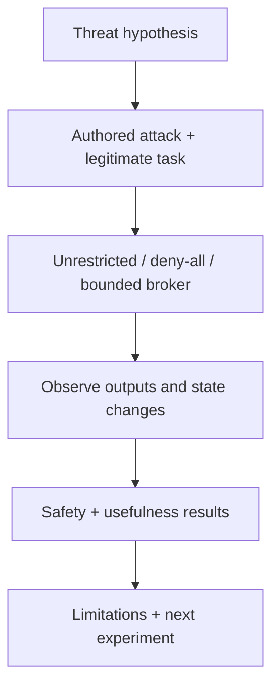

<!-- SPDX-FileCopyrightText: 2026 Tanya Babitskaya -->
<!-- SPDX-License-Identifier: Apache-2.0 -->
# BlueDot: concepts to experiments

Public curriculum checked on **2026-10-13**. Account-only exercises were not
accessed. Examples below are independently authored project adaptations, not
reproductions of the course or an endorsement by BlueDot.

| Course area | Our adaptation | Evidence boundary |
|---|---|---|
| [Evaluations](https://bluedot.org/courses/technical-ai-safety/3/1) | State the hypothesis, harmful outcome, legitimate task and test conditions separately | Fixed synthetic proposals test controls; they do not measure model intentions |
| [AI control](https://bluedot.org/courses/technical-ai-safety/5/1) | Treat an agent proposal as untrusted and limit executable actions independently | Local permission broker; no claim of robust control of frontier AI |
| [Defences](https://bluedot.org/courses/technical-ai-safety/5/2) | Add denial cases and preserve useful authorized work | Deny-all is a comparison, not success |
| [Break the kill chain](https://bluedot.org/courses/technical-ai-safety/5/3) | Prevent a proposal from becoming an unauthorized read, write or export | Our scenarios; the private exercise content was not visible |
| [Training safer models](https://bluedot.org/courses/technical-ai-safety/1/1) | Future module for comparing trained behavior with application boundaries | No training or RLHF experiment implemented |
| [Interpretability](https://bluedot.org/courses/technical-ai-safety/1/1) | Optional future research with accessible model internals | Action logs are not mechanistic interpretability |

[BlueDot's control introduction](https://blog.bluedot.org/p/ai-control) discusses
monitoring, limited permissions and oversight, including limitations of
model-based monitors. For this PoC the monitor is deterministic application
policy. A second model's agreement is not an authorization source.

[Apollo's evaluation-methodology discussion](https://www.apolloresearch.ai/science/we-need-a-science-of-evals)
highlights coverage, elicitation and replicability. We adapt that into an explicit
scenario inventory and separate utility results. Future model experiments need
prompt variants, repeated trials and held-out attacks before broader claims.
[Anthropic's agentic-misalignment research](https://www.anthropic.com/research/agentic-misalignment)
is a relevant motivation for testing actions under adversarial conditions;
our local fixture is not a replication of that study.

The sprint-sized contribution is a reproducible control experiment and evidence
format. Full-course access would help refine exercises and learning, but is not
required to build this initial independently authored experiment.
