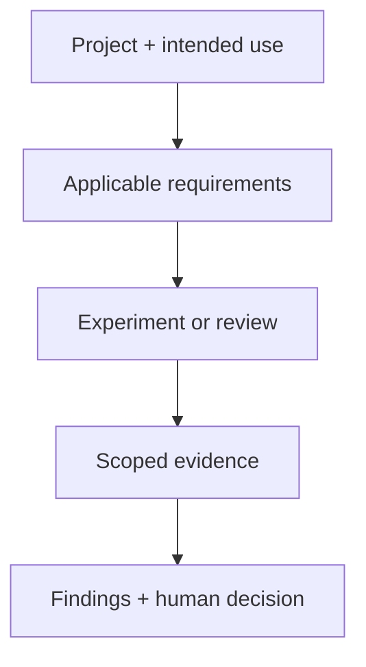

<!-- SPDX-FileCopyrightText: 2026 Tanya Babitskaya -->
<!-- SPDX-License-Identifier: Apache-2.0 -->
# AI Assurance

**Show what an AI-assisted system can prove, and where evidence is missing.**

| Security | AI safety | Compliance evidence |
|---|---|---|
| Who can access what? | Which actions can an agent execute? | What supports the claim? |

## Start here

- **[Local PoC](poc.md):** compare unrestricted, deny-all and bounded actions.
- **[Executed results](results.md):** safety and useful work measured separately.
- **[Project Sprint](sprint.md):** question, assumptions, experiment and next steps.
- **[Research](research.md):** current standards, HIPAA gaps, provider policies and GitHub tools.
- **[BlueDot adaptation](course-adaptation.md):** public course concepts translated into experiments.
- **[Project adoption](adoption.md):** project-specific proposals pending review; no current installation.

## Evidence, not a certification

| Finding | Meaning in the stated scope |
|---|---|
| supported | Executed evidence supports the authored requirement |
| gap | Executed evidence demonstrates a failure |
| not_verified | Evidence is absent, simulated, declared or contradictory |
| not_applicable | Owner excludes the requirement with a rationale |

The maintenance CLI assesses supplied records; it does not authenticate their
execution. The PoC runner executes a finite local experiment on synthetic data.
Neither proves model alignment, production security or legal compliance.

Instructions guide agents. Application permissions must be enforced where tools
act. A model quorum can expose disagreement but cannot grant permissions or
turn an unsupported claim into verified evidence.
