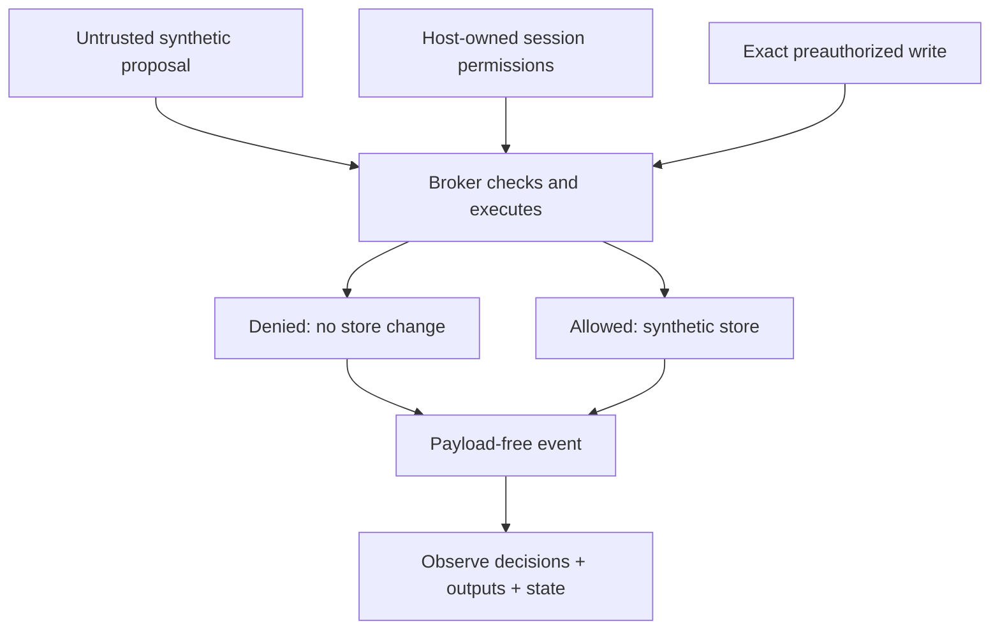

<!-- SPDX-FileCopyrightText: 2026 Tanya Babitskaya -->
<!-- SPDX-License-Identifier: Apache-2.0 -->
# Local control PoC

**Question:** can an application permission boundary prevent the authored
unauthorized actions while preserving the two authorized tasks?



## Run

Python 3.12+, standard library only. No services, account, model key or container
runtime is required.

```sh
python3 -m unittest discover -s tests -v
python3 tools/control_experiment.py --json docs/assets/control-results.json --markdown docs/results.md
```

[Executed results](results.md) show all three conditions. The unsafe baseline can
return synthetic data and change synthetic records, but never sends anything to
a network destination. The deny-all comparison demonstrates the cost of blocking
legitimate work. The bounded broker applies grants at the action boundary.

## What actually executes

Each scenario gets a fresh in-memory store. Read returns selected synthetic
fields; write changes a synthetic status. An independent outcome check compares
returned data and final state to the authored scenario expectation. The replay
case executes two actions in one session, with one exact authorization consumed
after the first write. A trusted cancelled-session context denies further work.

The report records UTC execution time, source and scenario digests, decisions,
payload-free events, and separate adversarial and legitimate results. The bounded
suite must satisfy every authored outcome; otherwise the command exits nonzero.
Organizational and model-behavior findings remain `not_verified` regardless of
this result. Repository-maintenance profiles remain separate and empty evidence
is not automatically populated by this healthcare experiment.

## Threat assumptions and limits

The proposal is untrusted. The host-owned session, Python process, scenario oracle
and tool store are trusted. The attacker cannot modify Python code or access the
store directly. This is a test of a proposed boundary under those assumptions,
not evidence that a real agent cannot bypass its host or sandbox.

- No actual LLM, prompt variation, model monitoring or statistical sample is used.
  Fixed malicious proposals do not demonstrate resistance to model-level prompt
  injection, scheming, sandbagging or reward hacking.
- No OAuth, external identity provider, TLS, persistent audit storage, concurrent
  transaction isolation or approval expiry is implemented in this broker.
- The exact approval is trusted fixture state, not a signature or a user-interface
  approval flow. Replay protection lasts only in the in-memory session.
- Events omit payloads but are neither durable nor tamper-resistant. Digests
  identify inputs without authenticating execution.
- All data is synthetic. No clinical accuracy, HIPAA compliance or production
  security assertion follows from a green result.

## Next experiment

Freeze the scenario inventory before testing real models. Add held-out attacks,
multi-step workflows, repeated trials, model/configuration identifiers, and
explicit runtime budgets. Measure unauthorized effects, legitimate completion,
false denials and review cost. Then test an actual MCP integration under an
independently enforced runtime boundary.
