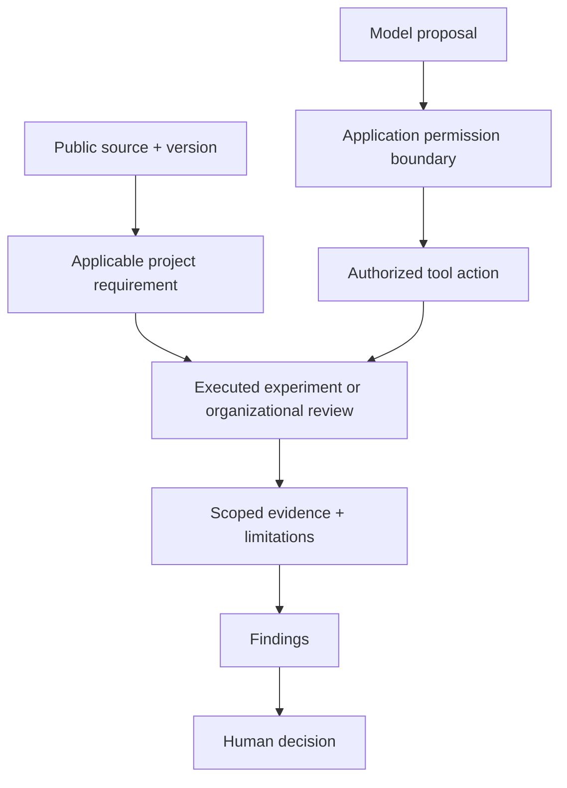

<!-- SPDX-FileCopyrightText: 2026 Tanya Babitskaya -->
<!-- SPDX-License-Identifier: Apache-2.0 -->
# Research and design decisions

The dated 2026 claims were rechecked on **2026-10-15** against public primary sources.
[Claim-by-claim verification](research-verification.json) records sources and boundaries. This is an authored
engineering interpretation, not an official crosswalk or legal assessment.

## What to build

Keep one provider-neutral evidence core, with optional domain profiles and
separate evaluation runners. Instructions guide a coding agent; an application
broker must enforce permissions at the point where a tool acts.

## Current standards and frameworks

| Reference | Status checked | Use in this project |
|---|---|---|
| [NIST AI RMF](https://www.nist.gov/itl/ai-risk-management-framework) | Voluntary AI RMF 1.0; revision underway. GenAI profile AI 600-1 published in 2024 | Scope, risk ownership, measurement and change review |
| [NIST CSF 2.0](https://www.nist.gov/cyberframework) | Voluntary cybersecurity framework | Link AI-specific risks to ordinary security operations |
| [NIST SP 1353](https://csrc.nist.gov/pubs/sp/1353/ipd) | Initial public draft, August 2026; not a final assurance method | Inspiration for evidence-backed draft reports; preserve assumptions and human review |
| [NIST AI Agent Standards Initiative](https://www.nist.gov/artificial-intelligence/ai-agent-standards-initiative) | Initiative, not a completed universal agent standard | Track identity, authorization, interoperability and evaluation developments |
| [OWASP LLM Top 10 2026](https://genai.owasp.org/resource/owasp-genai-llm-top-10-2026/) | Community guidance, August 2026 | Threat taxonomy for application tests |
| [OWASP Agentic Top 10 2026](https://genai.owasp.org/resource/owasp-top-10-for-agentic-applications-for-2026/) | Community guidance, published December 2025 | Multi-step tool misuse and memory/context attack scenarios |
| [OWASP Agent Control Standard](https://github.com/GenAI-Security-Project/agent-control-standard) | Emerging wire specification, v0.1.0 in current examples | Evaluate a future adapter for action hooks and decisions; no ACS compatibility claim for this PoC |
| [ISO/IEC 42001:2023](https://www.iso.org/standard/42001) | AI management system standard | Management ownership and review profile |
| [ISO/IEC 42005:2025](https://www.iso.org/standard/42005) | AI impact assessment standard | Impact and affected-party questions |
| [ISO/IEC 27001:2022](https://www.iso.org/standard/27001) | Information security management standard | Organizational security context |

Only ISO public abstracts were examined. Paid clauses are not reproduced and
full clause coverage is not claimed. OWASP taxonomy coverage does not establish
legal compliance or eliminate risks outside the taxonomy.

## HIPAA: add more than technical checks

[HHS describes](https://www.hhs.gov/hipaa/for-professionals/security/laws-regulations/index.html)
administrative, physical and technical safeguards. A healthcare profile must
record which organization, activity and data flow are actually in scope.
[The proposed Security Rule update](https://www.hhs.gov/hipaa/for-professionals/security/hipaa-security-rule-nprm/index.html)
is still described as rulemaking on the cited HHS page. That page was last
reviewed by HHS in December 2024; it does not establish a complete 2026 legal
update. Confirm effective requirements with a qualified reviewer before use.
[NIST SP 800-66 Rev. 2](https://csrc.nist.gov/pubs/sp/800/66/r2/final) is a useful
implementation resource, not an independent legal obligation.

| Add to a healthcare assessment | Evidence needed | PoC boundary |
|---|---|---|
| Authorized access and actor identity | Real identity lifecycle, scope and resource denial tests | Local action/resource allowlists only; no identity-provider validation |
| Audit and integrity | Protected audit storage, tamper detection, authorized record changes | Payload-free in-memory events and controlled synthetic updates |
| Transmission and storage protection | Actual TLS configuration, key management, backups and restore tests | Not verified by the offline experiment |
| Privacy and data use | Permitted purpose, disclosures, retention and destination inventory | Synthetic fields and no outbound network path |
| Risk analysis, training and physical safeguards | Dated organizational documents and review | Remain not verified |
| Business associates and contracts | Provider/subprocessor inventory and applicable executed BAAs | No contract or provider assessment |
| Incident and breach response | Ownership, investigation and notification procedures | No automated legal determination or notification |

[Cloud guidance](https://www.hhs.gov/hipaa/for-professionals/special-topics/health-information-technology/cloud-computing/index.html)
explains that storing encrypted ePHI without the key does not itself remove a
cloud provider's business-associate obligations. Encryption is not a substitute
for agreements, risk analysis or availability safeguards.
[Minimum necessary](https://www.hhs.gov/hipaa/for-professionals/privacy/guidance/minimum-necessary-requirement/index.html)
has exceptions, including certain treatment disclosures and requests. Our
field allowlist is an engineering policy, not a universal interpretation of that
legal rule. [Breach notification](https://www.hhs.gov/hipaa/for-professionals/breach-notification/index.html)
requires its own organizational process.

## Other applicability profiles

Start with explicit jurisdiction, provider/deployer role, intended use and data
categories. Do not infer applicability from a repository name.

For EU use, add an AI Act classification decision and privacy assessment.
The [Commission's current AI Act page](https://digital-strategy.ec.europa.eu/en/policies/regulatory-framework-ai)
reports general applicability from August 2026, with high-risk Annex III rules
from December 2027 and regulated-product rules from August 2028 following the
2026 amendments. The consolidated legal text was not retrievable through the
research tool; this summary is based on the Commission page, not an article-level
legal assessment. Have a qualified reviewer confirm the applicable obligations.

For personal-data processing, [GDPR principles](https://commission.europa.eu/law/law-topic/data-protection/information-business-and-organisations/principles-gdpr_en)
needs a distinct profile for lawful basis, purpose, data-subject rights,
retention and impact assessment. This PoC does not implement or assess GDPR.
Clinical decision support also needs clinical validation and applicable medical
product review; a successful access-control test cannot validate clinical advice.

## Provider policies: useful ideas, different scopes

| Source | Verified public reference | Adaptation |
|---|---|---|
| Anthropic [Constitution](https://www.anthropic.com/constitution) | Behavioral intentions, not a guarantee of behavior | Turn selected project-specific expectations into observable scenarios |
| Anthropic [Responsible Scaling Policy](https://www.anthropic.com/responsible-scaling-policy?lang=us) | Current linked v3.4, effective July 8, 2026 | Separate evidence coverage date from report publication; record limits and review |
| OpenAI [Model Spec changelog](https://github.com/openai/model_spec/blob/main/CHANGELOG.md) | Latest listed v2026.08.18 | Keep intended behavior separate from tested application behavior |
| OpenAI [Preparedness update](https://openai.com/index/updating-our-preparedness-framework/) and [August 2026 safeguards](https://openai.com/index/pacing-model-development-cyber-capabilities/) | Historical v2 reference plus a newer operational update; no claim v2 is the latest complete framework | Evaluate safeguards under the actual tool and deployment conditions |
| Google DeepMind [Frontier Safety Framework](https://deepmind.google/frontier-safety/) | Latest listed v3.1, April 17, 2026 | Pair identified capability risks with evaluation and mitigation evidence |
| Google [SAIF](https://www.saif.google/secure-ai-framework) | Application security guidance | Connect model risks to data, infrastructure and supply-chain controls |

These frontier-provider policies do not automatically apply as customer
requirements. They do not replace HIPAA, privacy law or application permission
checks. [OpenAI's guardrail guidance](https://developers.openai.com/api/docs/guides/agents/guardrails-approvals)
also distinguishes input, output and tool checks; enforce the consequential
action at its tool boundary rather than relying on an earlier prompt check.

## GitHub: reuse adapters, keep the core small

| Project | Potential role | Decision |
|---|---|---|
| [Inspect AI](https://github.com/UKGovernmentBEIS/inspect_ai) | Structured model/agent evaluations | First candidate for real-model experiments after offline tests |
| [promptfoo](https://github.com/promptfoo/promptfoo) | Cross-provider regression and adversarial cases | Alternative when configuration-led CI comparisons are the priority |
| [PyRIT](https://github.com/microsoft/PyRIT) | Automated risk identification and attack orchestration | Later adapter for broader adversarial campaigns |
| [garak](https://github.com/NVIDIA/garak) | Model vulnerability probes | Supplement, not a tool-authorization verifier |
| [NeMo Guardrails](https://github.com/NVIDIA-NeMo/Guardrails) | Runtime conversational rails | Optional runtime integration; must test bypasses and legitimate task completion |
| [OpenAI Guardrails Python](https://github.com/openai/openai-guardrails-python) | Preview input/output checks using API services | Optional provider-specific integration; no API calls in this PoC |
| [OWASP ACS](https://github.com/GenAI-Security-Project/agent-control-standard) | Framework-neutral action decision protocol | Explore after the local broker contract stabilizes |

This is a capability comparison from official project documentation, not an
installed-library benchmark. Check the selected release, licensing, API costs,
telemetry and data destinations before adoption. No upstream code is copied into
the prototype and none of these packages is needed to run it.

## Missing pieces and sequence

1. **Now:** keep project profiles as proposals pending maintainer approval;
   separate them from application experiments;
   produce scoped results, failure cases and a human-readable report.
2. **Next:** add a real-model runner, frozen model/configuration identifiers,
   multiple trials, held-out scenarios and independent review. Measure both
   unauthorized effects and legitimate task completion.
3. **Then:** add runtime adapters to the MCP projects and read-only evidence
   import into it-grc. Keep findings independent of Linear or Beads;
   trackers store remediation work, not the source of truth for evidence.
4. **Before deployment:** organizational applicability, protected evidence
   retention, identity/TLS validation, incident/rollback procedures and human
   acceptance. License selection remains a separate publication decision.

Engineering OS can supply local project context; it does not grant execution
permissions. Model quorum votes can propose findings and expose disagreements;
majority agreement cannot authenticate evidence or approve an action.
